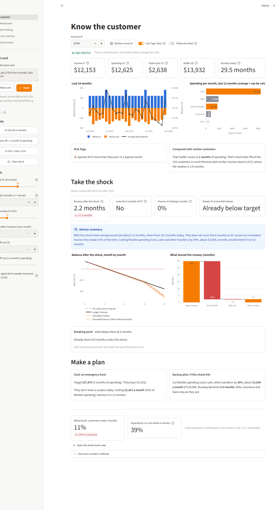
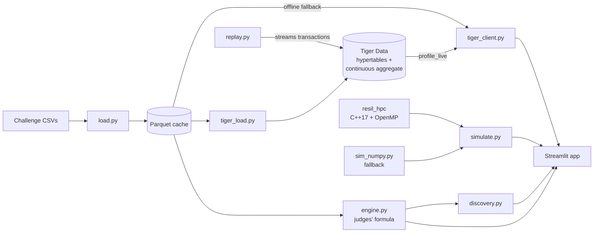

# Resilience Rewired

**How long can a customer last after a shock, and how likely are they to make it?**

Enter any account, apply a twist card (job loss, EI, rising bills, a surprise cost) and watch the customer and the whole bank update live. The headline number is always the judges' runway formula, computed exactly. Around it, a C++ simulation core runs 10,000 possible futures per customer, and Tiger Data keeps every number current as new transactions arrive.

*Sheridan Datathon 2026 · Tangerine track · "Resilience Rewired"*



> [!IMPORTANT]
> **Main finding: the twist is the early warning.** Stress-testing every customer against the EI twist each month flags **71% of the loans that later defaulted, a median of 16 months before the default was on record**. Flagged customers defaulted **8x as often** (35% vs 4.2%), using only data the bank had at the time.

## Features

- **The judges' number, exactly.** I, S, F, H, B, P and the runway formula, tested against hand-worked accounts and every one of the 4,500 customers.
- **Twist card reader.** Paste the card ("EI 55% for 6 months and bills up 15%") and it fills in the sliders, showing what it understood before applying.
- **Survival probability.** "Runway 3.4 months, and a 22% chance of making the full 6 months on EI", with a fan chart of possible balances.
- **Breaking point.** The formula in reverse: the income, one-off cost or bills increase that would break the customer.
- **Plans.** An emergency-fund goal, and a backup plan that cuts flexible spending first while bills, insurance and loans stay fixed.
- **Whole-bank stress test.** All 4,500 customers x 2,000 futures x 24 months in about 0.6 s, rerun on every slider move.
- **Live feed.** Transactions stream into a Tiger Data hypertable; a continuous aggregate moves the customer's numbers within a second of each new month.
- **Time machine.** Replay a customer who defaulted and see when the engine would have warned.
- **Works offline.** Every panel the live twist needs falls back to a local Parquet cache, and the C++ core falls back to NumPy.

## How it fits together



| Piece | What it does |
|---|---|
| [engine.py](engine.py) | Profiles, runway, breaking point, twist presets. The source of truth |
| [tiger/schema.sql](tiger/schema.sql), [tiger/views.sql](tiger/views.sql) | Transactions hypertable (columnstore, segmented by account), `monthly_flows` continuous aggregate, `monthly_live` and `profile_live` views |
| [hpc/src/resil.cpp](hpc/src/resil.cpp) | Monte Carlo core: one xoshiro256+ stream per (customer, path), OpenMP across customers, pybind11 zero-copy NumPy in and out |
| [sim_numpy.py](sim_numpy.py) | The same model in NumPy: the reference and the fallback |
| [discovery.py](discovery.py), [discovery.ipynb](discovery.ipynb) | Every finding as a named, repeatable function |
| [app.py](app.py), [app_pages/](app_pages/) | The Streamlit app |

## Getting started

You need Python 3.12, [uv](https://docs.astral.sh/uv/) and a C++ compiler with OpenMP (Visual Studio Build Tools on Windows, GCC or Clang elsewhere). Put the challenge CSVs in `data/`.

```bash
uv venv --python 3.12 && uv pip install -r requirements.txt ./hpc   # builds the C++ core
python load.py                                                        # CSVs -> Parquet cache, checks row counts
streamlit run app.py
```

> [!TIP]
> If the C++ build fails, the app still runs on the NumPy fallback and shows a "NumPy" badge. Set `RESIL_FORCE_NUMPY=1` to rehearse that.

### Live data with Tiger Data (optional)

Copy `.env.example` to `.env` and set `TIGER_DATABASE_URL`, then:

```bash
python check_cloud.py                                   # connects and checks the TimescaleDB extensions
python tiger_load.py                                    # loads 1M transactions, builds the views (~2 min)
python replay.py --account 20111 --from 2025-06 --speed 2
```

Open a twist straight from a link, which is handy for rehearsals: `http://localhost:8501/?account=20396&twist=EI 55% for 6 months`.

Turn on **Follow live feed** on the Customer page while `replay.py` runs: the KPIs, runway and survival chance move as each month lands. Without Tiger Data, the app reads the Parquet cache and shows an "Offline cache" badge.

### Command line

```bash
python engine.py 20111 --ei 0.55 --bills 0.15   # judges' runway and breaking point for one account
python engine.py --all                           # all 4,500 accounts, timed
python discovery.py                              # recompute every finding
python bench.py                                  # Python vs NumPy vs C++ benchmark
```

## Checks

```bash
python -m pytest
```

106 tests check that:

- The engine matches 3 hand-worked accounts and runs all 4,500 customers in under 1 s.
- Tiger Data's `profile_live` matches the engine on 50 random accounts.
- `monthly_live` reproduces the challenge's monthly table on every flow column, across all 185,326 account-months.
- With noise off, the simulation lands on the judges' runway (within 0.05) for every customer.
- C++ matches NumPy within 1 point.
- Every app page runs with the network off.

Tiger Data tests skip themselves when the database isn't reachable.

## Benchmark

4,500 customers x 2,000 futures x 24 months = 216M simulated months ([docs/bench.md](docs/bench.md)):

| Method | Time | Speed-up |
|---|---|---|
| Pure Python loop | 3.3 min | 1x |
| NumPy (vectorised) | 17.5 s | 11x |
| C++ OpenMP, 1 thread | 3.7 s | 54x |
| C++ OpenMP, 8 threads | **0.56 s** | **357x** |

## Data and sources

- Bank data: the PKDD'99 Financial dataset (a Czech bank, CTU Prague), as prepared by the challenge. Not included in this repo.
- Canadian figures (EI maximum, CPI) are listed with links in [SOURCES.md](SOURCES.md).
- The full plan and the judges' definitions are in [docs/ROADMAP.md](docs/ROADMAP.md); the write-up is in [docs/WRITEUP.md](docs/WRITEUP.md).
