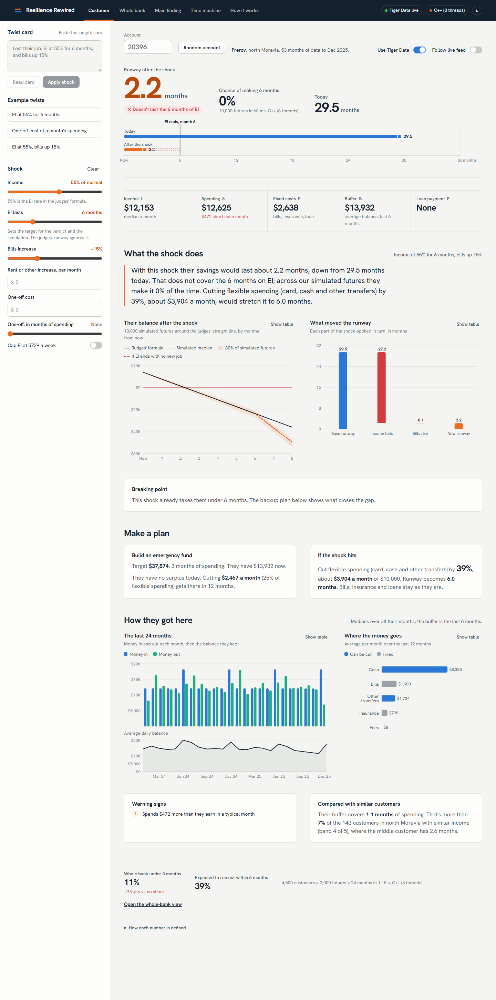
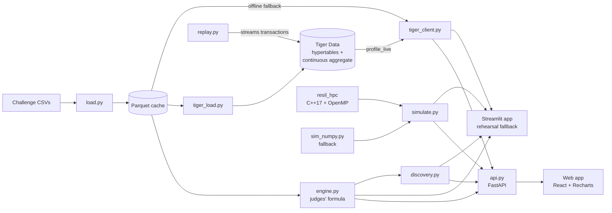

# Toonie

**How long can a customer last after a shock, and how likely are they to make it?**

Enter any account, apply a twist card (job loss, EI, rising bills, a surprise cost) and watch the customer and the whole bank update live. The headline number is always the judges' runway formula, computed exactly. Around it, a C++ simulation core runs 10,000 possible futures per customer, and Tiger Data keeps every number current as new transactions arrive.

*Sheridan Datathon 2026 · Tangerine track · built for the "Resilience Rewired" challenge*



> [!IMPORTANT]
> **Main finding: the twist is the early warning.** Stress-testing every customer against the EI twist each month flags **71% of the loans that later defaulted, a median of 16 months before the default was on record**. Flagged customers defaulted **8x as often** (35% vs 4.2%), using only data the bank had at the time.

## Features

- **The judges' number, exactly.** I, S, F, H, B, P and the runway formula, tested against hand-worked accounts and every one of the 4,500 customers.
- **Twist card reader.** Paste the card ("EI 55% for 6 months and bills up 15%") and it fills in the sliders, showing what it understood before applying. The rule-based reader always runs; with a Gemini key, Gemini reads the card too, so phrasings like "hours cut by a third" or "a month and a half of spending" work, and the panel says whether the rule reader agrees.
- **Assistant.** An **Ask** panel on every page: ask detailed questions ("what if they lost their job for 6 months?", "which customers are most at risk?") or tell it what to change ("open account 20111, add a $2,500 one-off, dark mode"). Answers come from the same engine tools as the panels and every figure is checked; changes apply on screen with an Undo. `?ask=<question>` opens a demo link already asking.
- **Say it for the customer.** Gemini rewords the advisor summary in plain, warm language from the engine's numbers only; any reply with a figure the engine didn't produce is thrown away and the rule-based summary is used instead.
- **Shock Autopilot.** Notices an income drop in the customer's own months (live from Tiger Data or the cache), then turns any shock into a ranked recovery ladder: pause transfers, trim card and cash spending, defer the loan. Each step is priced from their last 12 months and shows the months of runway it adds; switching steps on re-runs the engine and the runway meter animates to the new figure. Built on market research: Canadian bank tools look backward (spending insights) or 7 days ahead (scheduled payments); none detects the shock and hands over a tailored plan.
- **Survival probability.** "Runway 3.4 months, and a 22% chance of making the full 6 months on EI", with a fan chart of possible balances.
- **Breaking point.** The formula in reverse: the income, one-off cost or bills increase that would break the customer.
- **Plans.** An emergency-fund goal, and a backup plan that cuts flexible spending first while bills, insurance and loans stay fixed.
- **Whole-bank stress test.** All 4,500 customers x 2,000 futures x 24 months in about 0.6 s, rerun on every slider move.
- **Stress surface (3D).** On the Whole bank page, a three.js surface of the share of all 4,500 customers under 3 months for every income-kept × bills-increase shock (546 scenarios, judges' formula). The blue and tangerine lines are the Main finding's employed and EI curves, a marker follows the current shock, hovering reads any point and clicking applies it. Every chart's table view applies here too.
- **A little delight.** The empty "Try a what-if" state and the not-found page carry a small 3D scene (a tangerine, a piggy bank and gold coins) built from three.js geometry, with no model files. It tilts toward the cursor; click the tangerine to spin it, the piggy bank to drop a coin in, or a coin to flip it. It animates only while visible and respects reduced motion.
- **Live feed.** Transactions stream into a Tiger Data hypertable; a continuous aggregate moves the customer's numbers within a second of each new month.
- **Time machine.** Replay a customer who defaulted and see when the engine would have warned.
- **Simple and advanced views.** Simple is for an advisor with a customer: how long the savings last, the odds, and what would help, in plain words with three levers. Advanced is for analysts and the judges: every lever and chart, the breaking point, the whole-bank drill-downs, the time machine, the model's workings and the data-source switches. The choice is remembered; `?view=advanced` opens it directly.
- **Works offline.** Every panel the live twist needs falls back to a local Parquet cache, and the C++ core falls back to NumPy.

## How it fits together



| Piece | What it does |
|---|---|
| [engine.py](engine.py) | Profiles, runway, breaking point, twist presets. The source of truth |
| [tiger/schema.sql](tiger/schema.sql), [tiger/views.sql](tiger/views.sql) | Transactions hypertable (columnstore, segmented by account), `monthly_flows` continuous aggregate, `monthly_live` and `profile_live` views |
| [hpc/src/resil.cpp](hpc/src/resil.cpp) | Monte Carlo core: one xoshiro256+ stream per (customer, path), OpenMP across customers, pybind11 zero-copy NumPy in and out |
| [sim_numpy.py](sim_numpy.py) | The same model in NumPy: the reference and the fallback |
| [discovery.py](discovery.py), [discovery.ipynb](discovery.ipynb) | Every finding as a named, repeatable function |
| [assistant.py](assistant.py) | The assistant: Gemini tool calling over engine read tools and on-screen action tools, with a figure check on every reply |
| [gemini_client.py](gemini_client.py) | Gemini for language only: structured twist-card reading and a number-checked advisor note, with a silent fallback |
| [web/src/charts/StressSurface.tsx](web/src/charts/StressSurface.tsx) | The 3D stress surface (React Three Fiber, drei), loaded only on the Whole bank page |
| [autopilot.py](autopilot.py) | Shock Autopilot: income-drop detection and the engine-priced recovery ladder |
| [api.py](api.py) | FastAPI layer: the engine, plans, simulation and discovery as JSON, and it serves the built web app |
| [web/](web/) | The production web app: React, TypeScript, Vite and Recharts. Every number comes from the API |
| [app.py](app.py), [app_pages/](app_pages/) | The original Streamlit app, kept as a rehearsal fallback |

## Getting started

You need Python 3.12, [uv](https://docs.astral.sh/uv/) and a C++ compiler with OpenMP (Visual Studio Build Tools on Windows, GCC or Clang elsewhere). Put the challenge CSVs in `data/`.

```bash
uv venv --python 3.12 && uv pip install -r requirements.txt ./hpc   # builds the C++ core
python load.py                                                        # CSVs -> Parquet cache, checks row counts
npm --prefix web ci && npm --prefix web run build                     # builds the web app into web/dist
python -m uvicorn api:app --port 8000                                 # API + web app on http://localhost:8000
```

You need Node 20 or later to build the web app. Once `web/dist` is built, one Python process serves the whole app.

### Developing the web app

Run the API and the Vite dev server side by side; Vite proxies `/api` to port 8000 and reloads on save.

```bash
python -m uvicorn api:app --port 8000 --reload
npm --prefix web run dev                                              # http://localhost:5173
```

The API is documented at `http://localhost:8000/api/docs`. The Streamlit app still runs with `streamlit run app.py`.

> [!TIP]
> If the C++ build fails, the app still runs on the NumPy fallback and shows a "NumPy" badge. Set `RESIL_FORCE_NUMPY=1` to rehearse that.

### Live data with Tiger Data (optional)

Copy `.env.example` to `.env` and set `TIGER_DATABASE_URL`, then:

```bash
python check_cloud.py                                   # connects and checks the TimescaleDB extensions
python tiger_load.py                                    # loads 1M transactions, builds the views (~2 min)
python replay.py --account 20111 --from 2025-06 --speed 2
```

Open a twist straight from a link, which is handy for rehearsals: `http://localhost:8000/?account=20396&twist=EI 55% for 6 months`. The web app also keeps the shock in the address bar (`?account=20396&inc=55&eim=6&bills=15`), so any view can be shared as it is.

Turn on **Follow live feed** on the Customer page while `replay.py` runs: the KPIs, runway and survival chance move as each month lands. Without Tiger Data, the app reads the Parquet cache and shows an "Offline cache" badge.

### Gemini (optional)

Add `GEMINI_API_KEY` to `.env` (see `.env.example`). It's used for language only, in [gemini_client.py](gemini_client.py): reading twist
cards and rewording the advisor note. Gemini never calculates; the engine computes every number, and without a key or a network the
app behaves exactly as before. The card reader and note use `gemini-3.5-flash-lite` (about 1 s a card, `GEMINI_MODEL`); the assistant uses `gemini-3.1-flash-lite` (1 to 2 s a reply, `GEMINI_CHAT_MODEL`). On the free tier each model allows 15 requests a minute and a chat turn uses 2 to 4, so the assistant falls back to the other model when one is rate-limited. For judging, enable billing on the Google Cloud project or expect short waits.

### Command line

```bash
python engine.py 20111 --ei 0.55 --bills 0.15   # judges' runway and breaking point for one account
python engine.py --all                           # all 4,500 accounts, timed
python discovery.py                              # recompute every finding
python bench.py                                  # Python vs NumPy vs C++ benchmark
```

### Public demo on Hugging Face Spaces

The public demo is at [huggingface.co/spaces/Re0821/toonie](https://huggingface.co/spaces/Re0821/toonie) (direct link: re0821-toonie.hf.space). It runs from the Parquet cache, without `data/` or Tiger Data, and uses the NumPy simulation.

Free Hugging Face accounts can only host Gradio Spaces on ZeroGPU, so [deploy/zerogpu/app.py](deploy/zerogpu/app.py) serves the unchanged FastAPI app through Gradio's server, with a no-op `@spaces.GPU` function that ZeroGPU requires and nothing calls. A PRO account can use the Docker Space in [deploy/space/](deploy/space/) instead (`--target docker`), which also builds the C++ core. [tools/make_space.py](tools/make_space.py) assembles the upload folder in `build/hf-space` from the tracked app files, `cache/`, the prebuilt front end and the target's own files.

To publish changes:

```bash
.venv/Scripts/python.exe tools/make_space.py
.venv/Scripts/hf.exe auth login
.venv/Scripts/hf.exe upload Re0821/toonie build/hf-space . --repo-type space --exclude "**/__pycache__/**"
```

To create the Space from scratch on another account: `hf repos create <user>/toonie --type space --space-sdk gradio --flavor zero-a10g --env GRADIO_SSR_MODE=false --public` (the environment variable lets the app's own home page win over Gradio's). Optional: in the Space's **Settings, Variables and secrets**, add `GEMINI_API_KEY` as a secret; every visitor then uses that key's quota.

## Checks

```bash
python -m pytest
```

118 tests check that:

- The engine matches 3 hand-worked accounts and runs all 4,500 customers in under 1 s.
- Tiger Data's `profile_live` matches the engine on 50 random accounts.
- `monthly_live` reproduces the challenge's monthly table on every flow column, across all 185,326 account-months.
- With noise off, the simulation lands on the judges' runway (within 0.05) for every customer.
- C++ matches NumPy within 1 point.
- Every app page runs with the network off.
- Every web API endpoint answers, returns the engine's exact numbers, and works with the network off.

Tiger Data tests skip themselves when the database isn't reachable.

## Benchmark

4,500 customers x 2,000 futures x 24 months = 216M simulated months ([docs/bench.md](docs/bench.md)):

| Method | Time | Speed-up |
|---|---|---|
| Pure Python loop | 3.3 min | 1x |
| NumPy (vectorised) | 17.5 s | 11x |
| C++ OpenMP, 1 thread | 3.7 s | 54x |
| C++ OpenMP, 8 threads | **0.56 s** | **357x** |

## Data and sources

- Bank data: the PKDD'99 Financial dataset (a Czech bank, CTU Prague), as prepared by the challenge. Not included in this repo.
- Canadian figures (EI maximum, CPI) are listed with links in [SOURCES.md](SOURCES.md).
- The full plan and the judges' definitions are in [docs/ROADMAP.md](docs/ROADMAP.md); the write-up is in [docs/WRITEUP.md](docs/WRITEUP.md); every number and formula is explained in [docs/HOW_IT_WORKS.md](docs/HOW_IT_WORKS.md).
